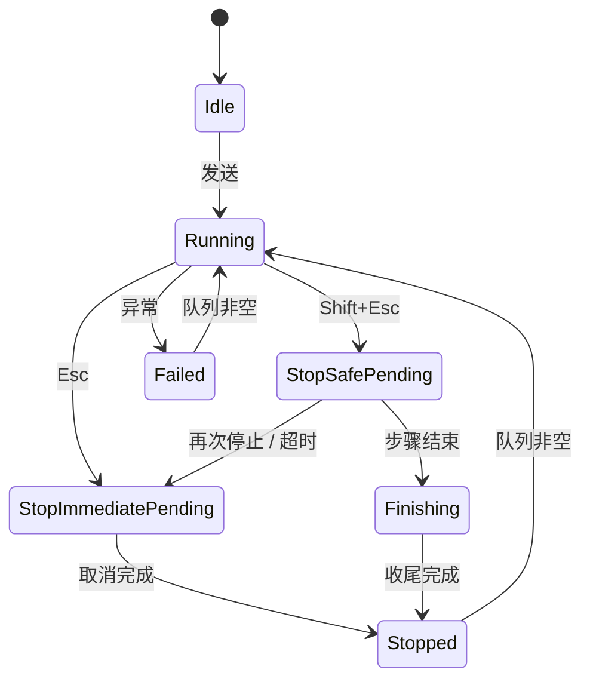

# 双档停止状态机设计

> 对应 TODO：①-IV-A 安全停止、①-IV 双档停止。只做设计，不包含实现。
> 现状依据：`MainForm.Agent.cs` 的 `RunConversationAsync`、`StopCurrent`、`StartNextQueuedMessage`。

## 1. 目标与约束

- 保留两种停止语义：急停立即生效；安全停止在步骤边界生效。
- 工具串行执行，同一时刻最多一个工具，不引入并行。
- 只有整轮彻底结束才发送队列中的下一条消息。
- 幂等：重复点击停止不会产生两次终止或两条错误提示。
- 可观测：停止原因、停止点、是否留下半成品都要能记录。

非目标：断点恢复（属于 ①-I-A）、崩溃诊断（①-II）。

## 2. 状态定义

| 状态 | 含义 |
| --- | --- |
| `Idle` | 没有运行中的轮次 |
| `Running` | 正常执行：发送、等待回复、解析、执行工具 |
| `StopSafePending` | 已请求安全停止，当前步骤仍在进行 |
| `StopImmediatePending` | 已请求急停，取消信号已发出，等待收尾 |
| `Finishing` | 当前步骤已结束，不再发起新步骤，等待收尾完成 |
| `Stopped` | 本轮已终止，记录停止原因，可发送队列下一轮 |
| `Failed` | 非停止原因导致的失败，记录异常后同样允许发送队列下一轮 |

## 3. 状态转移

| 当前 | 事件 | 下一状态 | 动作 |
| --- | --- | --- | --- |
| Idle | 用户发送 | Running | 创建 CancellationTokenSource，进入循环 |
| Running | Esc / 急停按钮 | StopImmediatePending | 取消令牌、终止 PowerShell、标记停止模式 immediate |
| Running | Shift+Esc / 安全停止 | StopSafePending | 仅置标志，不取消令牌，不杀进程 |
| StopSafePending | 当前工具或回复正常结束 | Finishing | 不再发起新工具，按 wrapUp 决定是否让模型收尾 |
| StopSafePending | 第二次停止请求 | StopImmediatePending | 升级为急停 |
| StopSafePending | 超过宽限期（默认 30 秒） | StopImmediatePending | 升级为急停，记录 escalated |
| StopImmediatePending | 页面回复停止 + 工具已退出 | Stopped | 记录 stopMode=immediate |
| Finishing | 收尾完成，或 wrapUp 关闭 | Stopped | 记录 stopMode=safe |
| Running | 未捕获异常 | Failed | 记录异常，队列照常发送 |
| Stopped / Failed | 队列非空 | Running | 发送下一条（现有 `StartNextQueuedMessage`） |



## 4. 可停止点

只在下列位置检查停止标志，其余时间不打断：

1. 循环顶部，发起下一次发送前。
2. 收到回复后、解析工具调用前。
3. 每次工具执行前。
4. 工具执行返回后、回填结果前。
5. 文件写入以“临时文件写完 + 原子改名完成”为边界，禁止中途放弃。
6. PowerShell 命令以进程退出或超时被杀为边界。

安全停止只阻止 1 和 3；2、4 之后必须进入 Finishing。急停则在任意等待点取消令牌立即生效。

## 5. 循环伪代码

```text
RunConversation(message):
  state = Running
  reply = SendAndReceive(message)
  while hop < 60:
    if state == StopImmediatePending: throw Canceled
    if state == StopSafePending or Finishing: break
    call = Parse(reply)
    if call == null: break
    state check before tool -> if stopping: break
    result = await ExecuteTool(call)        // 安全停止时允许完成
    if state == StopSafePending:
        state = Finishing
        Finish(result)                       // wrapUp ? 发送总结 : 直接结束
        break
    reply = SendAndReceive(result)
  Stopped
```

`Finish` 的默认策略：`wrapUp=false`，直接结束，避免额外模型往返与费用；需要总结时由配置打开。无论是否 wrapUp，都不再执行工具。

## 6. 边界情况

| 场景 | 处理 |
| --- | --- |
| 等待回复时按安全停止 | 让当前回复接收完成；超过宽限期升级急停 |
| 长 PowerShell 命令 | 安全停止等待退出；30 秒后强杀并升级急停 |
| 确认对话框打开 | 视为步骤内，安全停止等对话框结果；急停直接取消等待 |
| 队列非空 | 停止完成后再发送；停止过程中不弹出、不自动确认 |
| 连续两次停止 | 第二次把安全停止升级为急停，不重复提示 |
| 停止时正在写文件 | 写完当前文件再停；若写失败记录 failed，不重试 |
| 页面仍在生成回复 | 沿用 `_waitPageIdleAfterStop`，发送前等待页面空闲 |

## 7. 宽限期与升级

- 默认 30 秒，配置项 `SafeStopGraceSeconds`，范围 5 到 300。
- 计时从进入 `StopSafePending` 开始，只统计当前步骤，不含队列等待。
- 超时先 `KillCurrent`，再取消令牌；状态转为 `StopImmediatePending`，日志记 `escalated=true`。
- PowerShell 强杀等待 5 秒，仍未退出则报 Failed 并记录进程 id。

## 8. UI 与状态回报

- 急停按钮点击与 Esc：立即急停。
- Shift+Esc：安全停止；按钮文案改为“安全停止中…”；再按 Esc 升级为急停。
- 状态栏依次显示：`安全停止：等待当前步骤完成…`、`正在急停…`、`已急停`。
- 回复区追加标记，区分 `[已急停]` 与 `[已安全停止]`，并列出已完成的最后一步。

## 9. 日志与持久化字段

每轮记录以下字段，供 ③-A 落盘与 ①-I-A 恢复使用：

- `stopMode`: none / immediate / safe / escalated
- `stopRequestedAt`、`stoppedAt`
- `lastCompletedStep`: 工具名或 reply
- `interruptedTool`: 名称、参数摘要、是否已产生文件变更
- `pendingWrite`: 临时文件路径与目标路径
- `completedFiles`: 本轮已写完的文件列表
- `escalated`: 布尔值

## 10. 实施拆分

1. 引入 `StopRequest` 枚举与状态字段，替换现有 `_runCts == null` 判断。
2. `StopCurrent` 拆为 `RequestStop(mode)`；急停路径保持现状，安全停止只置标志。
3. `RunConversationAsync` 在 4 个检查点插入状态判断，工具执行后进入 Finishing。
4. 宽限期定时器放在 `MainForm.Monitor.cs`，超时升级并记录。
5. UI 增加 Shift+Esc 与按钮状态文案。
6. 工具执行器保证文件原子写，并在日志中输出步骤边界信息。
